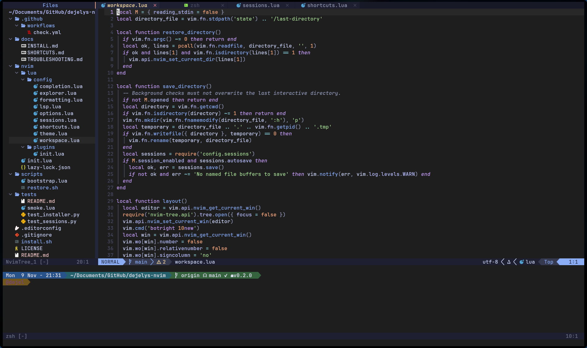
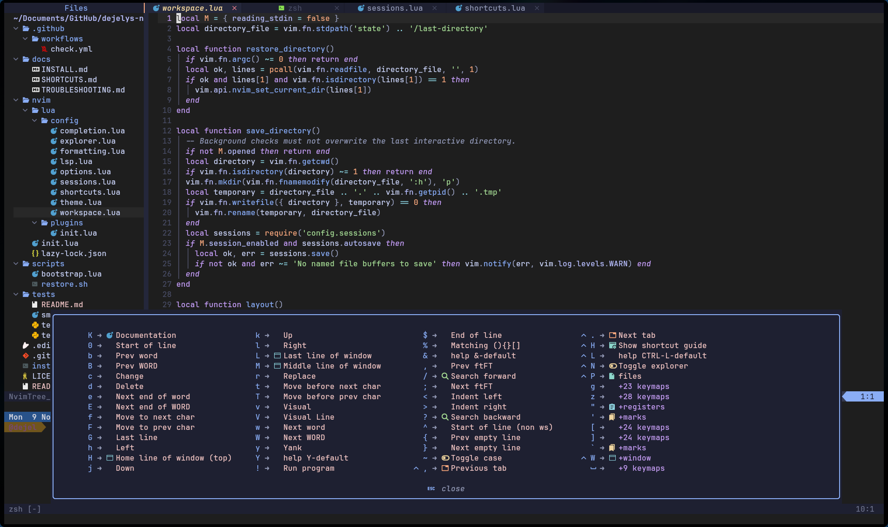
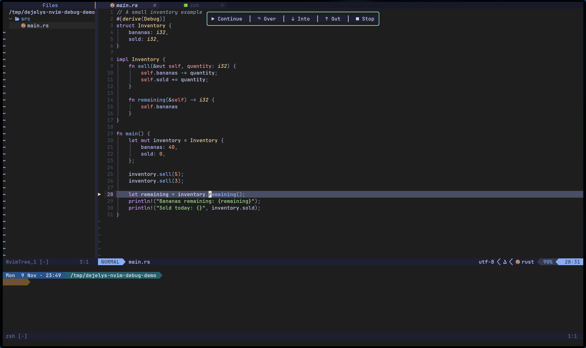

# dejely's nvim

A Neovim setup with a file explorer, searchable files, a bottom terminal,
completion, language servers, formatting, and a dark Catppuccin theme.



The actual setup editing its own configuration. Terminal font and shell prompt
come from my local terminal settings; the installer leaves yours unchanged.

<details>
<summary>Shortcut discovery with Ctrl+H</summary>



Press **Ctrl+H** in normal mode to open this guide, or pause after **Space** to
discover leader shortcuts. Press **Esc** to close it.

</details>

<details>
<summary>Compact debugging toolbar</summary>



Debug Rust, C, and C++ with a floating toolbar. It stays near the top while
debugging; variables and output open only when requested. See the
[debugging guide](docs/DEBUGGING.md).

</details>

## Install

On Linux or macOS, install the [prerequisites](docs/INSTALL.md#prerequisites), then run:

```sh
curl -fsSL https://raw.githubusercontent.com/dejely/dejelys-nvim/v0.3.0/install.sh | bash
```

The installer backs up your existing Neovim config, plugins, state, and cache.
It installs Neovim 0.12.6 and tree-sitter 0.27.2 locally if compatible versions
are missing, verifies those downloads against pinned SHA-256 checksums, and
installs the locked plugins, language tools, and syntax parsers. It does not use
sudo or edit your shell configuration. Close Neovim before installing.

Run `nvim` afterward. If needed, add this to your shell configuration:

```sh
export PATH="$HOME/.local/bin:$PATH"
export EDITOR=nvim VISUAL=nvim
```

For an inspectable installation, dependency instructions, updates, or restoring
your old setup, see [Installation](docs/INSTALL.md).

## Everyday keys

**Space is the leader key.** Press the keys in sequence: `Space f f`, for example.
Most shortcuts use normal mode; press `Esc` first.

| Keys | Action |
| --- | --- |
| `Ctrl+P` or `Space f f` | Find a file |
| `Space f g` | Search project contents |
| `Space f b` | Choose an open file |
| `Ctrl+.` / `Ctrl+,` | Next / previous tab in the top bar |
| `Ctrl+N` | Toggle the file explorer |
| `Ctrl+H` or `Space ?` | Show available shortcuts (normal mode) |
| `Space e` | Reveal the current file in the explorer |
| `Ctrl+W`, then `h/j/k/l` | Focus left/down/up/right window |
| `Space f m` | Format the file or selection |
| `gd` / `gr` | Definition / references |
| `K` | Documentation under the cursor |
| `Space r n` | Rename a symbol |
| `:w` / `:q` | Save / close a window (press Enter) |
| `u` / `Ctrl+R` | Undo / redo |
| `Ctrl+O`, then `u` | Undo while typing, then return to insert mode |
| `Space s s` / `Space s r` | Save / restore the current directory's session |
| `Space s d` | Stop session autosave until restart |
| `F5` / `F10` / `F11` | Start or continue / step over / step into |
| `Space b b` / `Space b u` | Toggle breakpoint / debug toolbar |

The [complete shortcut guide](docs/SHORTCUTS.md) covers movement, selection,
copy/paste, buffers, actual Vim tab pages, completion, diagnostics, Git, terminals,
and the explorer. [Troubleshooting](docs/TROUBLESHOOTING.md) covers terminal keys,
language tools, clipboard support, and installation failures.

## What opens

The explorer appears on the left, your shell opens in a small bottom split, and
focus starts in the editor. Launch with `nvim path/to/project` to restore that
directory's saved files, cursor positions, splits, and Vim tab pages. With no
argument, Neovim returns to the last interactive directory and restores its
session. Sessions save automatically on normal exit.

`nvim path/to/file` opens the requested file without restoring or overwriting the
directory's saved session. Headless runs, piped input, diff mode, and externally
restored sessions skip the automatic layout/session flow. The terminal starts a
fresh shell; running jobs and unsaved file contents are not saved. See the
[session guide](docs/SHORTCUTS.md#sessions) for manual controls and details.

## Included

- Catppuccin Macchiato, charcoal background, absolute line numbers, four-space fallback indentation.
- Bufferline, nvim-tree, fzf-lua, lualine, indentation guides, and Git change markers.
- TypeScript/JavaScript, Python, JSON, and Lua language servers installed through Mason.
- Rust language support when `rust-analyzer` is available on PATH.
- StyLua, Prettier, Ruff, and optional rustfmt formatting through Conform.
- Project indentation through `.editorconfig`; manual formatting with project formatter settings.
- Persistent undo under Neovim's state directory.
- Per-directory sessions and which-key shortcut discovery on Ctrl+H or after pausing on Space.
- On-demand Rust/C/C++ debugging through CodeLLDB, with a clickable floating toolbar.
- Syntax parsers for Rust, JS/TS/TSX, Python, JSON/JSONC, Lua, Vimscript, Markdown, Bash, HTML, CSS, and YAML.
- Plugin revisions recorded in `nvim/lazy-lock.json`.

This is the portable version of my configuration. It chooses your shell and does
not include my desktop shortcuts, terminal font settings, shell customizations,
or CAD environment handling. A Nerd Font is optional but improves file icons.

## Customize

| File after installation | Purpose |
| --- | --- |
| `~/.config/nvim/init.lua` | Leader key and plugin bootstrap |
| `lua/config/options.lua` | Editor settings and tab shortcuts |
| `lua/config/workspace.lua` | Startup layout and remembered directory |
| `lua/config/sessions.lua` | Per-directory session save/restore and controls |
| `lua/config/shortcuts.lua` | Shortcut popup and leader-key groups |
| `lua/config/debugging.lua` | Debugger adapter, launch defaults, and shortcuts |
| `lua/config/debug_toolbar.lua` | Floating toolbar and variable inspector |
| `lua/config/explorer.lua` | Explorer filters and actions |
| `lua/config/lsp.lua` | Language servers and diagnostics |
| `lua/config/completion.lua` | Completion keys and sources |
| `lua/config/formatting.lua` | Formatters and format shortcut |
| `lua/config/theme.lua` | Theme and terminal colors |
| `lua/plugins/init.lua` | Plugin declarations |

Paths above assume default XDG directories. Restart Neovim after editing Lua.
Use `:Lazy`, `:Mason`, `:ConformInfo`, `:checkhealth`, and `:messages` to inspect
your setup. For development checks, see [tests/README.md](tests/README.md).

## License

MIT for the configuration and installer. Plugins and downloaded tools retain
their own licenses; their source repositories are linked in the plugin declarations.

## Lightweight editor workflow

Use Ctrl+Shift+P (or Space f p) for commands, Space f k for keybindings,
Space d x for project diagnostics, and Ctrl+backtick (or Space f t) to toggle
the existing terminal without stopping its shell. Ctrl+S saves; with an LSP
attached, F2 renames, F12 jumps to definitions, and Alt+Enter opens code actions.

Completion, formatting, pickers, and file tools load on demand. Large files
(above 1 MiB or lines longer than 10,000 bytes) automatically skip expensive
highlighting, indentation guides, buffer-word indexing, and LSP attachment.
See [the shortcut guide](docs/SHORTCUTS.md) for behavior and fallback mappings.
